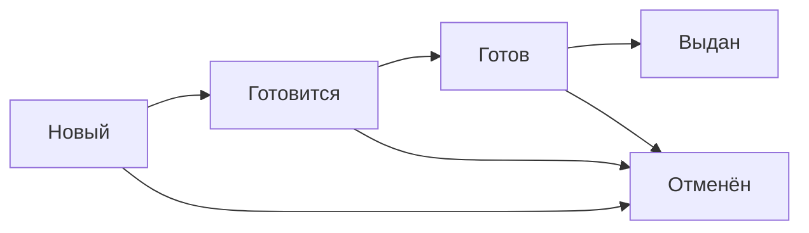

[README.md](https://github.com/user-attachments/files/34914289/README.md)
# CafeGo

Веб-приложение для заказа еды из кафе: клиент выбирает блюда в меню, собирает корзину и оформляет заказ на самовывоз, а администратор ведёт меню и обрабатывает заказы.

> **Статус:** этап проектирования. Архитектура готова, код в разработке.

## Возможности (MVP)

- Регистрация и вход по email и паролю
- Меню по категориям с фото, описанием, ценой и поиском
- Корзина (хранится в браузере)
- Оформление заказа на самовывоз: «как можно скорее» или ко времени, комментарий
- «Мои заказы» со статусами и отмена заказа, пока его не начали готовить
- Панель администратора: категории, блюда, стоп-лист, заказы и смена статусов

## Роли

| Роль | Возможности |
|---|---|
| Гость | Смотреть меню, искать блюда, собирать корзину, регистрироваться и входить |
| Клиент | Оформлять заказы, видеть и отменять свои заказы |
| Администратор | Управлять меню, видеть все заказы, менять их статусы |

## Стек

- **Фронтенд:** React (Vite)
- **Бэкенд:** Node.js, Express
- **База данных:** PostgreSQL
- **ORM** (работа с базой из кода): Prisma
- **Безопасность:** bcrypt (хеширование паролей), JWT (вход), Helmet, CORS

## Статусы заказа



## Структура проекта

```
cafego/
├── docs/
│   └── architecture.md      # Архитектура проекта
├── client/                  # Фронтенд (React + Vite)
├── server/                  # Бэкенд (Express + Prisma)
│   └── src/                 # routes → controllers → services → database
└── README.md
```

## Документация

Подробная архитектура: [docs/architecture.md](docs/architecture.md)

В документе описаны:

- роли, MVP и пользовательские истории
- бизнес-правила
- база данных (таблицы, связи, ER-диаграмма)
- API (эндпоинты с примерами запросов и ответов)
- страницы, структура папок, безопасность
- план расширения проекта

## Запуск

Инструкция по запуску будет добавлена после реализации проекта.
