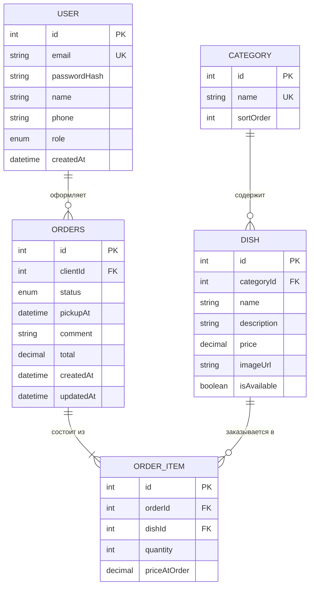
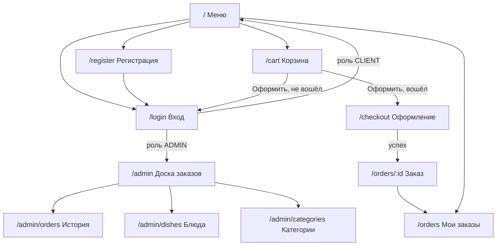

# Архитектура проекта «CafeGo» — заказ еды из кафе

**Стек:** React (Vite) + Node.js + Express + PostgreSQL + Prisma
**Версия документа:** 1.0 (до начала написания кода)

---

## 0. О проекте и допущения

**Что делает сайт.** Клиент открывает меню кафе, собирает корзину и оформляет заказ на самовывоз. Администратор кафе ведёт меню и обрабатывает заказы: принял → готовит → готово → выдан.

**Для кого.** Для посетителей небольшого кафе и для его администратора.

**Какую проблему решает.** Не нужно звонить и диктовать заказ. Кафе не теряет заказы и видит все в одном списке со статусами.

**Допущения** (я принял их сам, их легко поменять):

- Кафе одно, в одном городе и в одном часовом поясе.
- Только **самовывоз**. Оплата при получении (наличными или картой в кафе).
- Блюдо либо есть в меню, либо нет. Размеров, добавок и «без лука» как отдельных опций нет (пожелания клиент пишет в комментарии).
- Кафе принимает заказы только в рабочие часы (задаются в настройках).
- Администраторов создаёт владелец через начальные данные в базе (seed). Зарегистрироваться как админ нельзя.

> **Почему так:** доставка и онлайн-оплата превращают проект в два-три раза более сложный (курьеры, адреса, платёжный сервис). Лучше сделать надёжный базовый сценарий «меню → корзина → заказ → статус», а остальное вынести в раздел «Расширение».

---

## 1. Пользователи и роли

| Роль | Кто это | Что может |
|---|---|---|
| **Гость** | Любой посетитель без входа | Смотреть меню, искать блюда, наполнять корзину. Зарегистрироваться и войти. |
| **Клиент** (`CLIENT`) | Зарегистрированный пользователь | Всё, что гость, плюс: оформить заказ, видеть **только свои** заказы, отменить свой заказ, пока его не начали готовить. |
| **Администратор** (`ADMIN`) | Сотрудник кафе | Всё, что клиент, плюс: управлять категориями и блюдами, видеть **все** заказы, менять их статус. |

> **Почему так:** роль хранится одним полем `role` у пользователя. Если сделать отдельные таблицы «клиенты» и «админы», придётся дублировать email, пароль и вход, и вход превратится в два разных кода.

---

## 2. MVP — минимальная первая версия

**MVP** (Minimum Viable Product) — самая маленькая версия, которой уже можно пользоваться.

### Что входит (8 функций)

1. Регистрация и вход (email + пароль).
2. Меню по категориям с фото, описанием и ценой, плюс поиск по названию.
3. Корзина (добавить, изменить количество, убрать, видеть сумму).
4. Оформление заказа на самовывоз: «как можно скорее» или ко времени, комментарий.
5. «Мои заказы»: список и статус каждого заказа.
6. Отмена заказа клиентом, пока он в статусе «Новый».
7. Админ: управление категориями и блюдами, включая «стоп-лист» (временно убрать блюдо).
8. Админ: список заказов и смена статусов.

### Что НЕ входит и почему

| Функция | Почему не в MVP |
|---|---|
| Доставка курьером | Нужны адреса, зоны, стоимость доставки, курьеры и их статусы. |
| Онлайн-оплата | Платёжный сервис, возвраты, неоплаченные заказы. Это почти отдельный проект. |
| Уведомления (email, push) | Нужны почтовый сервис или WebSocket. Сначала нужно, чтобы сам заказ работал. |
| Промокоды и скидки | Усложняют расчёт суммы. Сначала нужна базовая сумма заказа. |
| Отзывы и рейтинг блюд | Не влияют на основной сценарий. |
| Размеры и добавки к блюдам | Резко усложняют таблицы и корзину. |
| Корзина в базе (синхронизация между устройствами) | В MVP корзина хранится в браузере (см. ниже). |
| Загрузка фото файлом | Нужно файловое хранилище. В MVP хватит ссылки на картинку. |
| Восстановление пароля | Требует почты. Администратор может сбросить вручную. |
| Статистика продаж | Не нужна для работы заказов, добавляется поверх существующих данных. |

### Важное решение: где хранится корзина

Корзина в MVP живёт **в браузере** (состояние React + `localStorage`). На сервер уходит только список «блюдо + количество» в момент оформления заказа.

> **Почему так:** гость может собирать корзину до регистрации, а в базе не появляются «брошенные» корзины. Минус: корзина не переносится между устройствами (это есть в «Расширении»). Главное правило: **цены в корзине только для показа**, а настоящую сумму всегда считает сервер.

---

## 3. Пользовательские истории

Формат: «Как [роль], я хочу [действие], чтобы [цель]».

| № | История | MVP |
|---|---|:---:|
| US-1 | Как **гость**, я хочу видеть меню по категориям с фото и ценами, чтобы выбрать, что заказать. | ✅ |
| US-2 | Как **гость**, я хочу искать блюдо по названию, чтобы быстро его найти. | ✅ |
| US-3 | Как **гость**, я хочу добавлять блюда в корзину, менять количество и видеть сумму, чтобы собрать заказ. | ✅ |
| US-4 | Как **гость**, я хочу зарегистрироваться, чтобы оформлять заказы. | ✅ |
| US-5 | Как **гость**, я хочу войти в аккаунт, чтобы получить доступ к своим заказам. | ✅ |
| US-6 | Как **клиент**, я хочу оформить заказ из корзины, указав время и комментарий, чтобы забрать еду в удобный момент. | ✅ |
| US-7 | Как **клиент**, я хочу видеть историю своих заказов и их статусы, чтобы знать, когда идти в кафе. | ✅ |
| US-8 | Как **клиент**, я хочу отменить заказ, пока его не начали готовить, чтобы не платить за ненужное. | ✅ |
| US-9 | Как **администратор**, я хочу управлять категориями меню, чтобы блюда были разложены понятно. | ✅ |
| US-10 | Как **администратор**, я хочу добавлять и менять блюда, их цену и фото, чтобы меню было актуальным. | ✅ |
| US-11 | Как **администратор**, я хочу временно убрать блюдо из меню (закончились продукты), чтобы его не заказывали. | ✅ |
| US-12 | Как **администратор**, я хочу видеть новые заказы и менять их статус, чтобы клиенты знали, что происходит. | ✅ |
| US-13 | Как **клиент**, я хочу повторить прошлый заказ в один клик, чтобы не собирать корзину заново. | ❌ |
| US-14 | Как **клиент**, я хочу получить уведомление, что заказ готов, чтобы не ждать зря. | ❌ |
| US-15 | Как **клиент**, я хочу оплатить заказ онлайн, чтобы не платить на месте. | ❌ |

---

## 4. Бизнес-правила

**Бизнес-правила** — правила предметной области, которые сервер проверяет **всегда**, что бы ни прислал браузер.

> **Общий ответ на вопрос «почему не в браузере»:** браузер контролирует пользователь. Любой может открыть DevTools (инструменты разработчика), подделать запрос через Postman или `curl` и обойти проверки на странице. Проверки в React нужны для удобства (быстро показать ошибку), а защищает данные только сервер.

| № | Правило | Почему нельзя проверять только в браузере |
|---|---|---|
| BR-1 | **Цены берёт сервер из базы.** Клиент присылает только `dishId` и `quantity`, сумму заказа считает сервер. | Если сумму присылает браузер, её можно изменить на 1 тенге прямо в запросе. |
| BR-2 | **Нельзя заказать недоступное блюдо** (`isAvailable = false`). | Корзина могла «залежаться» в `localStorage`, а блюдо уже в стоп-листе. Актуальное состояние знает только база. |
| BR-3 | **Количество — целое число от 1 до 20, в заказе минимум одна позиция.** | Пустой заказ, `-5` или `99999` можно отправить прямым запросом. |
| BR-4 | **Клиент видит и отменяет только свои заказы.** | Достаточно поменять номер в адресе (`/orders/42` → `/orders/43`) и увидеть чужие данные. |
| BR-5 | **Клиент может отменить заказ только в статусе `NEW`.** После начала готовки отмена невозможна (только через администратора). | Статус меняется на сервере, и страница может показывать устаревшее состояние. |
| BR-6 | **Статус меняется только администратором и только по цепочке.** `NEW → PREPARING → READY → COMPLETED`. Отмена `CANCELLED` из любого незавершённого статуса. Из `COMPLETED` и `CANCELLED` выхода нет. | Кнопки можно скрыть в React, но запрос `PATCH` можно отправить вручную с любым статусом. |
| BR-7 | **Заказ принимается только в рабочие часы кафе.** Желаемое время получения (если указано): сегодня, не раньше чем через 20 минут и не позже закрытия. | Время на компьютере клиента можно подделать. Верное «сейчас» знает только сервер. |
| BR-8 | **Заказ и его позиции сохраняются целиком или не сохраняются совсем** (в одной транзакции). | Если сервер упадёт посередине, без транзакции останется «пустой» заказ без блюд. |
| BR-9 | **Блюдо и категорию нельзя удалить, если они есть в заказах** (блюдо скрывается: `isAvailable = false`; в непустой категории удалять нельзя). | Иначе старые заказы «повиснут» без блюда. Это знает только база. |
| BR-10 | **Меню и статусы меняет только `ADMIN`.** Регистрация всегда создаёт `CLIENT`, поле `role` из запроса игнорируется. | Иначе любой отправит `"role": "ADMIN"` при регистрации. |
| BR-11 | **Email уникален, пароль не короче 8 символов.** | Дубли аккаунтов и слабые пароли можно создать запросом в обход формы. |

**Деньги** хранятся в типе `Decimal` (точные десятичные числа), а не `Float`: из-за округления дробных чисел в JavaScript `0.1 + 0.2 = 0.30000000000000004`, и копейки «уплывают».

**Часовой пояс.** Время в базе хранится в UTC (всемирное время), а рабочие часы кафе считаются по часовому поясу кафе (задаётся в `.env`).

---

## 5. База данных

### 5.1. Таблицы и поля

В Prisma модель называется `Order`, а в базе таблица `orders` (слово `order` зарезервировано в SQL).

**Таблица `User` (пользователи)**

| Поле | Тип | Примечание |
|---|---|---|
| id | Int, PK, autoincrement | Первичный ключ (уникальный номер строки) |
| email | String, unique | Логин |
| passwordHash | String | Хеш пароля, не сам пароль |
| name | String | Имя |
| phone | String, nullable | Телефон для связи по заказу |
| role | Enum `CLIENT` / `ADMIN` | По умолчанию `CLIENT` |
| createdAt | DateTime | Когда создан |

**Таблица `Category` (категории меню)**

| Поле | Тип | Примечание |
|---|---|---|
| id | Int, PK | |
| name | String, unique | «Бургеры», «Напитки» |
| sortOrder | Int | Порядок показа в меню |

**Таблица `Dish` (блюда)**

| Поле | Тип | Примечание |
|---|---|---|
| id | Int, PK | |
| categoryId | Int, FK → Category | Внешний ключ: ссылка на строку другой таблицы |
| name | String | «Чизбургер» |
| description | String, nullable | Состав, вес |
| price | Decimal(10,2) | Текущая цена |
| imageUrl | String, nullable | Ссылка на фото |
| isAvailable | Boolean | `false` = нет в меню (стоп-лист или скрыто) |

Индекс: `categoryId` (меню постоянно фильтруется по категории).

**Таблица `Order` (заказы)**

| Поле | Тип | Примечание |
|---|---|---|
| id | Int, PK | Он же номер заказа |
| clientId | Int, FK → User | Кто заказал |
| status | Enum `NEW` / `PREPARING` / `READY` / `COMPLETED` / `CANCELLED` | По умолчанию `NEW` |
| pickupAt | DateTime (UTC), nullable | Желаемое время получения; `null` = как можно скорее |
| comment | String, nullable | Пожелания клиента |
| total | Decimal(10,2) | Итоговая сумма, посчитанная сервером |
| createdAt | DateTime | |
| updatedAt | DateTime | Обновляется при смене статуса |

Индексы: (`clientId`, `createdAt`) для «моих заказов» и (`status`, `createdAt`) для админской доски.

**Таблица `OrderItem` (позиции заказа)**

| Поле | Тип | Примечание |
|---|---|---|
| id | Int, PK | |
| orderId | Int, FK → Order | К какому заказу относится |
| dishId | Int, FK → Dish | Какое блюдо |
| quantity | Int | Количество (1–20) |
| priceAtOrder | Decimal(10,2) | Цена одной порции **на момент заказа** |

Уникально: (`orderId`, `dishId`), то есть одно блюдо в заказе одной строкой с количеством.

### 5.2. Связи

| Связь | Тип | Как реализована |
|---|---|---|
| Category → Dish | один-ко-многим | В категории много блюд, у блюда одна категория (`Dish.categoryId`) |
| User → Order | один-ко-многим | У клиента много заказов (`Order.clientId`) |
| Order → OrderItem | один-ко-многим | В заказе много позиций (`OrderItem.orderId`) |
| Dish → OrderItem | один-ко-многим | Блюдо встречается во многих позициях (`OrderItem.dishId`) |
| Order ↔ Dish | **многие-ко-многим** | В заказе много блюд, блюдо в многих заказах. Связь через таблицу `OrderItem`, в которой лежат ещё `quantity` и `priceAtOrder` |

> **Почему так (OrderItem):** в одной ячейке заказа нельзя хранить «список блюд». Промежуточная таблица — стандартное решение, и в ней естественно живут количество и цена. Если хранить блюда строкой «3,3,7», нельзя посчитать «сколько раз заказали чизбургер», и база не проверит, что такое блюдо существует.

### 5.3. ER-диаграмма



### 5.4. Проверка: дублирование и расширяемость

**Дублирование данных**

- `OrderItem.priceAtOrder` дублирует `Dish.price` **сознательно**. Если администратор поднимет цену, старые заказы сохранят цену, по которой клиент их оформил.
- `Order.total` можно вычислить из позиций (сумма `priceAtOrder × quantity`). Это тоже сознательное дублирование: сумма фиксируется один раз, и для списка заказов не нужно каждый раз считать её заново.
- Имя и телефон клиента в заказ **не копируются**, они берутся из `User` по `clientId`. Изменил телефон один раз, он обновился везде.
- Название блюда в позицию не копируется, только ссылка `dishId`. Поэтому блюдо нельзя удалять, только скрывать (BR-9). Если понадобятся «неизменные чеки», можно будет добавить поле `dishNameAtOrder`.

**Можно ли добавить функцию, не ломая таблицы**

| Будущая функция | Что меняется в базе | Ломает ли старое |
|---|---|---|
| Доставка | Новые поля в `Order` (тип, адрес, стоимость доставки) | Нет, поля необязательные |
| Онлайн-оплата | Новая таблица `Payment` + новый статус в enum | Нет |
| Промокоды | Таблица `Promo` + поле `discount` в `Order` | Нет |
| Отзывы | Таблица `Review` со ссылками на `Dish` и `User` | Нет |
| Размеры и добавки | Таблицы опций + связь с `OrderItem` | Потребует убрать уникальность (`orderId`, `dishId`), но данные сохранятся |
| Корзина в базе | Таблицы `Cart` и `CartItem` | Нет |

> **Почему так:** новые функции в основном добавляют **новые таблицы или необязательные поля**, а не меняют существующие. Это самый безопасный способ расти.

---

## 6. API

**API** (Application Programming Interface) — набор адресов сервера, к которым обращается React. Все адреса начинаются с `/api`. Данные ходят в формате JSON.

**Коды ответов:** `200` ОК, `201` создано, `400` неверные данные, `401` не вошли в систему, `403` нет прав, `404` не найдено, `409` конфликт (действие невозможно в текущем состоянии).

### 6.1. Таблица эндпоинтов

**Эндпоинт** — «адрес + метод» (например, `GET /api/categories`). У корзины своего эндпоинта нет: она живёт в браузере (US-3), а актуальные цены для неё приходят через `GET /api/dishes?ids=`.

| Метод | Адрес | Что делает | Доступ | История |
|---|---|---|---|---|
| POST | `/api/auth/register` | Регистрация, создаёт клиента | Гость | US-4 |
| POST | `/api/auth/login` | Вход, возвращает токен | Гость | US-5 |
| GET | `/api/auth/me` | Данные текущего пользователя по токену | Клиент, Админ | US-5 |
| GET | `/api/categories` | Список категорий | Все | US-1 |
| GET | `/api/dishes?categoryId=&q=&ids=` | Блюда в наличии (фильтры: категория, поиск, список id) | Все | US-1, US-2, US-3 |
| GET | `/api/dishes/:id` | Одно блюдо | Все | US-1 |
| POST | `/api/orders` | Оформить заказ | Клиент, Админ | US-6 |
| GET | `/api/orders/my` | Мои заказы | Клиент, Админ | US-7 |
| GET | `/api/orders/:id` | Один заказ (свой или любой для админа) | Клиент, Админ | US-7 |
| PATCH | `/api/orders/:id/cancel` | Отменить свой заказ (статус `NEW`) | Клиент, Админ | US-8 |
| POST | `/api/categories` | Создать категорию | Админ | US-9 |
| PUT | `/api/categories/:id` | Изменить категорию | Админ | US-9 |
| DELETE | `/api/categories/:id` | Удалить пустую категорию | Админ | US-9 |
| GET | `/api/admin/dishes` | Все блюда, включая скрытые | Админ | US-10, US-11 |
| POST | `/api/dishes` | Создать блюдо | Админ | US-10 |
| PUT | `/api/dishes/:id` | Изменить блюдо (в том числе `isAvailable`) | Админ | US-10, US-11 |
| DELETE | `/api/dishes/:id` | Скрыть блюдо (`isAvailable=false`) | Админ | US-10 |
| GET | `/api/orders?status=&date=` | Все заказы с фильтрами | Админ | US-12 |
| PATCH | `/api/orders/:id/status` | Сменить статус заказа | Админ | US-12 |

### 6.2. Примеры запросов и ответов

**Единый формат ошибки (для всех эндпоинтов):**

```json
{ "error": { "code": "DISH_UNAVAILABLE", "message": "Блюдо «Чизбургер» сейчас недоступно" } }
```

**POST `/api/auth/register`** (US-4)

```json
// Запрос
{ "email": "ali@example.com", "password": "secret123", "name": "Али", "phone": "+77001234567" }

// Ответ 201
{ "id": 7, "email": "ali@example.com", "name": "Али", "role": "CLIENT" }
```

Ошибки: `400` (короткий пароль), `409` (email уже занят).

**POST `/api/auth/login`** (US-5)

```json
// Запрос
{ "email": "ali@example.com", "password": "secret123" }

// Ответ 200
{ "token": "eyJhbGciOi...", "user": { "id": 7, "name": "Али", "role": "CLIENT" } }
```

Ошибка: `401` с одним общим текстом «Неверный email или пароль».

**GET `/api/categories`** (US-1)

```json
// Ответ 200
[ { "id": 1, "name": "Бургеры", "sortOrder": 1 }, { "id": 2, "name": "Напитки", "sortOrder": 2 } ]
```

**GET `/api/dishes?categoryId=1&q=чиз`** (US-1, US-2)

```json
// Ответ 200
[ { "id": 3, "categoryId": 1, "name": "Чизбургер", "description": "Говядина, сыр, соус", "price": "1900.00", "imageUrl": "https://..." } ]
```

Для корзины (US-3): `GET /api/dishes?ids=3,7` возвращает свежие цены и наличие. Если блюда нет в ответе, оно недоступно и должно быть убрано из корзины.

**POST `/api/orders`** (US-6). Токен в заголовке `Authorization: Bearer <token>`.

```json
// Запрос: цен нет, сервер возьмёт их сам
{
  "items": [ { "dishId": 3, "quantity": 2 }, { "dishId": 7, "quantity": 1 } ],
  "pickupAt": "2026-11-20T13:30:00+05:00",   // или null = как можно скорее
  "comment": "Без лука, пожалуйста"
}

// Ответ 201
{
  "id": 42, "status": "NEW", "pickupAt": "2026-11-20T08:30:00.000Z", "comment": "Без лука, пожалуйста",
  "total": "4300.00",
  "items": [
    { "dishId": 3, "name": "Чизбургер", "quantity": 2, "priceAtOrder": "1900.00" },
    { "dishId": 7, "name": "Лимонад", "quantity": 1, "priceAtOrder": "500.00" }
  ]
}
```

Ошибки: `400` (пустой заказ, количество вне 1–20, время получения неверное), `401`, `409` (`DISH_UNAVAILABLE`, `CAFE_CLOSED`).

**GET `/api/orders/my`** (US-7)

```json
// Ответ 200
[ { "id": 42, "status": "PREPARING", "total": "4300.00", "createdAt": "2026-11-20T07:50:00.000Z" } ]
```

**GET `/api/orders/42`** (US-7)

```json
// Ответ 200: как ответ POST /api/orders (позиции, сумма, статус)
```

Ошибки: `403` (чужой заказ у клиента), `404`.

**PATCH `/api/orders/42/cancel`** (US-8)

```json
// Запрос: тело не нужно
// Ответ 200
{ "id": 42, "status": "CANCELLED" }
```

Ошибки: `403` (чужой заказ), `409` (`ORDER_ALREADY_IN_PROGRESS`, заказ уже готовится).

**POST `/api/categories`** (US-9, Админ). `PUT` принимает те же поля.

```json
// Запрос
{ "name": "Десерты", "sortOrder": 3 }

// Ответ 201
{ "id": 3, "name": "Десерты", "sortOrder": 3 }
```

Ошибки: `403` (не админ), `409` (`CATEGORY_NOT_EMPTY` при удалении непустой категории).

**POST `/api/dishes`** (US-10, Админ). `PUT` принимает те же поля.

```json
// Запрос
{ "categoryId": 3, "name": "Чизкейк", "description": "Нью-Йорк, 120 г", "price": 1500, "imageUrl": "https://...", "isAvailable": true }

// Ответ 201
{ "id": 9, "name": "Чизкейк", "price": "1500.00", "isAvailable": true }
```

**PUT `/api/dishes/9`**: стоп-лист (US-11, Админ)

```json
// Запрос
{ "isAvailable": false }

// Ответ 200
{ "id": 9, "isAvailable": false }
```

**DELETE `/api/dishes/9`** (US-10, Админ)

```json
// Ответ 200: блюдо не удаляется, а скрывается
{ "id": 9, "isAvailable": false }
```

**GET `/api/orders?status=NEW&date=2026-11-20`** (US-12, Админ)

```json
// Ответ 200
[ { "id": 42, "status": "NEW", "total": "4300.00", "pickupAt": "2026-11-20T08:30:00.000Z",
    "client": { "name": "Али", "phone": "+77001234567" },
    "items": [ { "name": "Чизбургер", "quantity": 2 } ] } ]
```

**PATCH `/api/orders/42/status`** (US-12, Админ)

```json
// Запрос
{ "status": "PREPARING" }

// Ответ 200
{ "id": 42, "status": "PREPARING" }
```

Ошибка: `409` (`INVALID_STATUS_TRANSITION`, например `NEW → COMPLETED`).

> **Почему так (в `POST /orders` нет цен):** запрос можно собрать вручную. Сервер находит блюда по `dishId`, берёт цены из базы, проверяет наличие и сам считает `total`.

> **Почему так (`DELETE` только скрывает):** настоящее удаление блюда сломало бы старые заказы (BR-9).

---

## 7. Страницы

### 7.1. Список страниц по ролям

| Роль | Страница | Адрес | Что на ней |
|---|---|---|---|
| Гость | Меню (главная) | `/` | Категории, карточки блюд, поиск, «В корзину» |
| Гость | Корзина | `/cart` | Позиции, количество, сумма, «Оформить» |
| Гость | Вход | `/login` | Форма входа |
| Гость | Регистрация | `/register` | Форма регистрации |
| Клиент | Оформление | `/checkout` | Время получения, комментарий, подтверждение |
| Клиент | Мои заказы | `/orders` | Список с кнопкой «Отменить» |
| Клиент | Заказ | `/orders/:id` | Состав и статус заказа |
| Админ | Доска заказов | `/admin` | Активные заказы по колонкам статусов |
| Админ | История заказов | `/admin/orders` | Все заказы с фильтрами |
| Админ | Блюда | `/admin/dishes` | Добавить, изменить, стоп-лист |
| Админ | Категории | `/admin/categories` | Управление категориями |

Клиент и админ видят также все страницы гостя, кроме входа и регистрации.

### 7.2. Карта страниц



> **Почему так:** страницы `/admin/*` нужно защищать **и** в React (чтобы клиент не видел лишнего), **и** на сервере (чтобы не получил данные). Защита только в React ничего не стоит: данные приходят из API, а API видит любой.

---

## 8. Структура папок проекта

```
cafego/
├── docs/
│   └── architecture.md
├── client/                      # Фронтенд (React + Vite)
│   ├── src/
│   │   ├── api/                 # Функции запросов к серверу (fetch)
│   │   ├── components/          # Повторяемые блоки: карточка блюда, кнопки, формы
│   │   ├── context/             # AuthContext (кто вошёл) и CartContext (корзина)
│   │   ├── hooks/               # Свои хуки (useAuth, useCart)
│   │   ├── pages/               # По одному файлу на страницу
│   │   ├── routes/              # Маршруты и защита страниц по ролям
│   │   ├── App.jsx
│   │   └── main.jsx
│   ├── index.html
│   └── package.json
├── server/                      # Бэкенд (Node.js + Express)
│   ├── prisma/
│   │   ├── schema.prisma        # Описание таблиц
│   │   ├── migrations/          # История изменений базы
│   │   └── seed.js              # Стартовые данные (админ, категории, блюда)
│   ├── src/
│   │   ├── routes/              # Адреса API
│   │   ├── controllers/         # Принимают запрос, возвращают ответ
│   │   ├── services/            # Бизнес-логика: auth, menu, orders
│   │   ├── database/            # Подключение Prisma (один общий клиент)
│   │   ├── middleware/          # Проверка токена, ролей, ошибок, валидации
│   │   ├── utils/               # Мелкие помощники (даты, деньги)
│   │   ├── config/              # Чтение .env
│   │   ├── app.js               # Настройка Express
│   │   └── server.js            # Запуск сервера
│   ├── .env                     # Секреты (НЕ в Git)
│   ├── .env.example             # Образец без секретов (в Git)
│   └── package.json
└── .gitignore
```

### Слои сервера: `routes → controllers → services → database`

| Слой | За что отвечает |
|---|---|
| **routes** | Связывает адрес и метод с нужным контроллером и подключает проверки (вошёл ли, какая роль). |
| **controllers** | Берёт данные из запроса, вызывает сервис и отправляет ответ с нужным кодом. Бизнес-правил здесь нет. |
| **services** | Хранит бизнес-правила (BR-1…BR-11): подсчёт суммы, проверка наличия, цепочка статусов, права на отмену. |
| **database** | Единственное место, которое общается с PostgreSQL через Prisma. |

> **Почему так:** если смешать всё в одном файле, любое изменение правила (например, «отмена только до статуса "Готовится"») придётся искать по всему проекту. При разделении правило живёт в одном месте, а подсчёт суммы заказа находится в одной функции сервиса `orders`.

---

## 9. Безопасность

### 9.1. Пароли

- Пароль **никогда** не хранится в открытом виде. В колонке `passwordHash` лежит **хеш** (необратимый «отпечаток» пароля), полученный библиотекой `bcrypt` (с «солью» — случайной добавкой, чтобы одинаковые пароли давали разные хеши).
- При входе пароль хешируется и сравнивается с сохранённым хешем.
- Хеш и пароль никогда не отправляются в ответах API.

> **Почему так:** если базу украдут, а пароли хранятся открыто, злоумышленник получит доступ ко всем аккаунтам. Многие используют один пароль на разных сайтах, так что пострадают и другие сервисы.

### 9.2. Как работает вход (JWT)

**JWT** (JSON Web Token) — подписанная строка, в которой лежит «кто это» и «до какого времени действует». Подделать её без секретного ключа сервера нельзя.

1. Клиент отправляет email и пароль на `POST /api/auth/login`.
2. Сервер проверяет пароль и создаёт JWT с `userId` и `role`. Срок жизни — например, 7 дней.
3. React сохраняет токен и добавляет его к каждому запросу в заголовок `Authorization: Bearer <token>`.
4. Сервер на каждом защищённом запросе проверяет подпись и срок токена.
5. Выход из аккаунта = клиент удаляет токен.

**Где хранить токен на клиенте.** Для учебного проекта выбираем `localStorage`: это просто. Недостаток: токен может украсть вредоносный скрипт на странице (XSS-атака). Поэтому нельзя вставлять в страницу чужой HTML (например, комментарий клиента показывать только как текст). В реальном проекте безопаснее `httpOnly`-cookie (куки, недоступная для JavaScript).

> **Почему так:** без токена сервер не знает, кто делает запрос, и каждый раз пришлось бы присылать пароль. Роль берётся из проверенного токена, а не из тела запроса.

### 9.3. Что лежит в `.env`

`.env` — файл с секретными настройками, **не попадает в Git** (добавить в `.gitignore`). В Git лежит `.env.example` с пустыми значениями.

| Переменная | Для чего |
|---|---|
| `DATABASE_URL` | Адрес и пароль от PostgreSQL |
| `JWT_SECRET` | Секретный ключ подписи токенов (длинная случайная строка) |
| `JWT_EXPIRES_IN` | Срок жизни токена, например `7d` |
| `PORT` | Порт сервера |
| `CLIENT_URL` | Адрес фронтенда (для CORS) |
| `CAFE_TIMEZONE` | Часовой пояс кафе, например `Asia/Almaty` |
| `CAFE_OPEN` / `CAFE_CLOSE` | Рабочие часы кафе, например `09:00` и `22:00` |
| `ADMIN_EMAIL` / `ADMIN_PASSWORD` | Данные первого администратора для `seed.js` |

> **Почему так:** секрет в репозитории виден всем, у кого есть доступ к коду. Утёкший `JWT_SECRET` позволяет создавать токены любого пользователя, включая админа.

### 9.4. Проверки доступа

| Проверка | Где | Что делает |
|---|---|---|
| `authRequired` | middleware | Нет токена или он неверный → `401` |
| `roleRequired('ADMIN')` | middleware | Роль не подходит → `403` |
| Проверка владельца | service | Заказ чужой и пользователь не админ → `403` |
| Валидация входных данных | middleware (например, библиотека `zod`) | Неверные типы, пустые поля, количество вне 1–20 → `400` |
| Пересчёт цен | service | Цены и сумма только из базы (BR-1) |
| CORS | `app.js` | Принимать запросы только с `CLIENT_URL` |
| Ограничение частоты запросов | middleware (`express-rate-limit`) | Защита от подбора пароля на `/auth/login` |
| Заголовки безопасности | `helmet` | Закрывает типовые уязвимости браузера |
| SQL-инъекции | Prisma | Запросы параметризуются автоматически, но не собирайте SQL строкой вручную |

> **Почему так:** на сообщении «Неверный email или пароль» нельзя уточнять, что именно неверно. Иначе по ответам можно узнать, какие email зарегистрированы.

---

## 10. Расширение — 3 функции на будущее

### 10.1. Доставка курьером

- **Что изменить:** в `Order` добавить необязательные поля `type` (самовывоз/доставка), `address`, `deliveryFee`; в оформлении заказа добавить выбор способа и адрес; в сумму заказа добавить стоимость доставки; при желании роль `COURIER` и статусы «В пути» / «Доставлен».
- **Риск переписывания:** небольшой, если сумма заказа считается **в одном месте**. Иначе доставку придётся добавлять в каждый файл, где считаются деньги.
- **Как избежать сейчас:** вся логика суммы живёт в одной функции сервиса `orders` (`calculateTotal`). Статусы хранятся как enum, поэтому новые значения добавляются миграцией без потери данных. Все новые поля делаем необязательными, чтобы старые заказы остались валидными.

### 10.2. Онлайн-оплата

- **Что изменить:** таблица `Payment` (сумма, статус, внешний id платежа), новый статус заказа `PENDING_PAYMENT`, эндпоинт приёма уведомлений от платёжной системы (webhook), правило «неоплаченный заказ автоматически отменяется через N минут» и возвраты при отмене.
- **Риск переписывания:** **самый большой**. Меняется весь путь заказа: теперь заказ создаётся, но «не принят», пока не оплачен, и кухня не должна видеть неоплаченные заказы.
- **Как избежать сейчас:**
  1. Список «активных» статусов, которые видит кухня (`NEW`, `PREPARING`, `READY`), берётся из одного места в коде, а не размазан по условиям.
  2. Цены и сумма хранятся в заказе (`priceAtOrder`, `total`), чтобы платёж не зависел от текущего меню.
  3. Переходы статусов описаны одной таблицей правил в `services/orders`, и новый статус добавляется туда одной строкой.

### 10.3. Промокоды и скидки

- **Что изменить:** таблица `Promo` (код, размер скидки, срок, лимит использований), поле `promoId` и `discount` в `Order`, поле для ввода кода в корзине и проверка кода на сервере.
- **Риск переписывания:** небольшой, если `calculateTotal` уже одна и сумма считается только на сервере (BR-1).
- **Как избежать сейчас:** никогда не считать сумму в браузере «по-настоящему». Корзина показывает ориентир, а итог всегда приходит от сервера.

> **Почему так:** все три функции затрагивают подсчёт суммы и статусы заказа. Главный принцип расширяемости: правило должно жить в одном месте. Тогда новая функция меняет одно место, а не двадцать.

---

## 11. Вопросы на защите

**1. Зачем разделять сервер на routes, controllers, services и database?**
У каждого слоя одна задача. Бизнес-правила (services) не зависят от того, как пришёл запрос и где хранятся данные, поэтому их легко менять и проверять, не трогая остальное.

**2. Почему корзина хранится в браузере, и откуда берутся цены в заказе?**
Корзина нужна гостю ещё до регистрации, а хранить её в базе в MVP незачем. Но цены в корзине только для показа: в `POST /orders` приходят только `dishId` и `quantity`, а цены и итоговую сумму сервер берёт из базы. Иначе сумму можно подделать запросом.

**3. Зачем нужна таблица OrderItem и поле `priceAtOrder`?**
Связь «заказ ↔ блюдо» многие-ко-многим, а в базе её нельзя хранить в одной ячейке, поэтому нужна промежуточная таблица, в которой лежат ещё количество и цена. Цена блюда может измениться, и копия цены сохраняет исторически верную сумму старых заказов.

**4. Как вы гарантируете, что заказ не окажется «наполовину сохранённым» и что статусы не перепутают?**
Заказ и его позиции создаются в одной транзакции («всё или ничего»). Смена статуса идёт только через сервер, и он разрешает лишь допустимые переходы (`NEW → PREPARING → READY → COMPLETED`, отмена из незавершённых), а для клиента отмена возможна только из `NEW`.

**5. Как защищены пароли и права администратора?**
Пароли хранятся как хеш `bcrypt` с солью. После входа сервер выдаёт JWT, подписанный секретом из `.env`. Роль берётся из проверенного токена, регистрация всегда создаёт `CLIENT` (поле `role` из запроса игнорируется), а админ создаётся только через начальные данные. Админские адреса защищены проверкой роли на сервере, а не только скрытыми кнопками в React.
